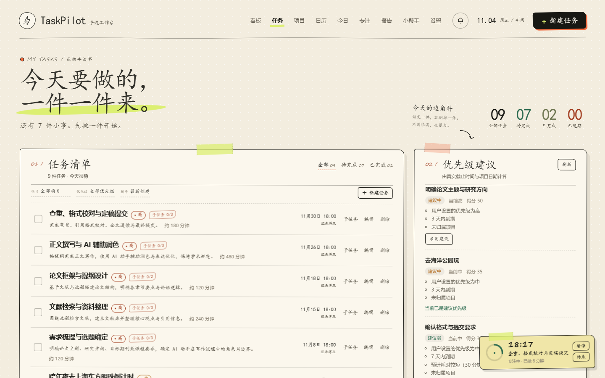
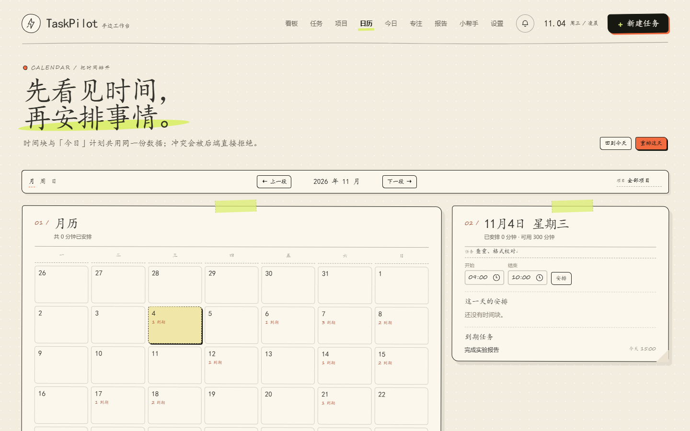
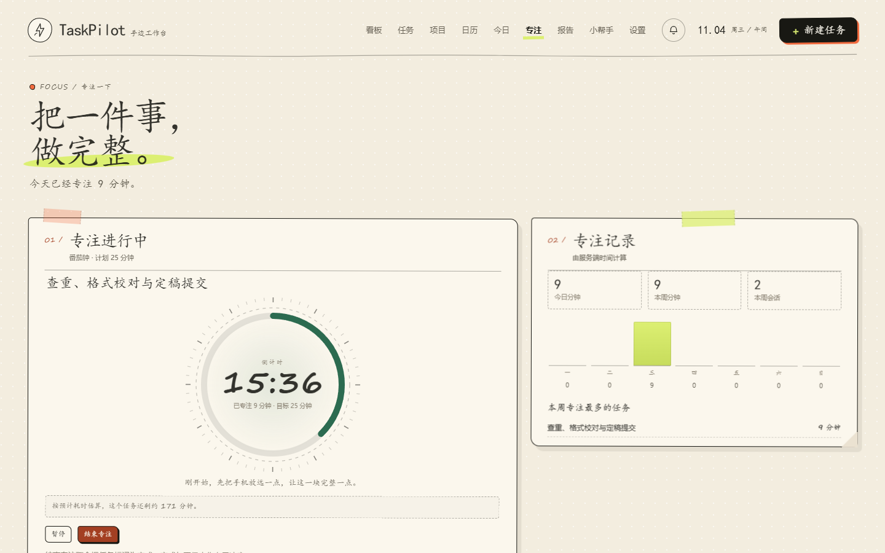
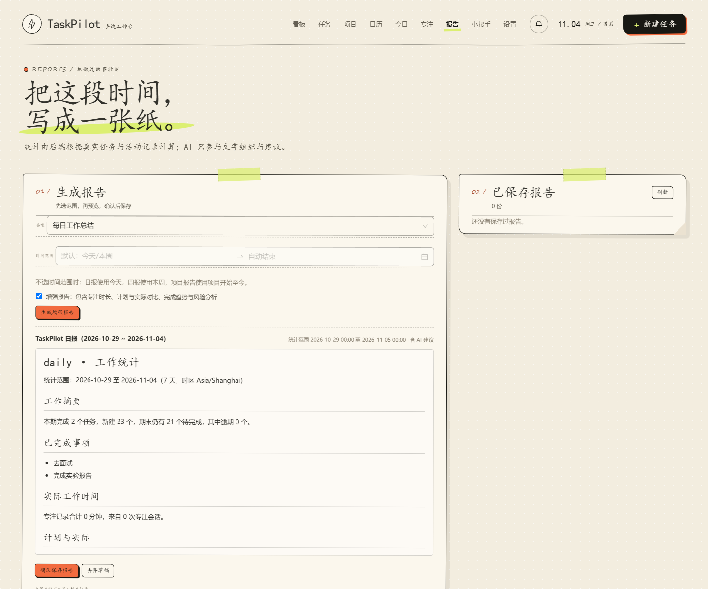
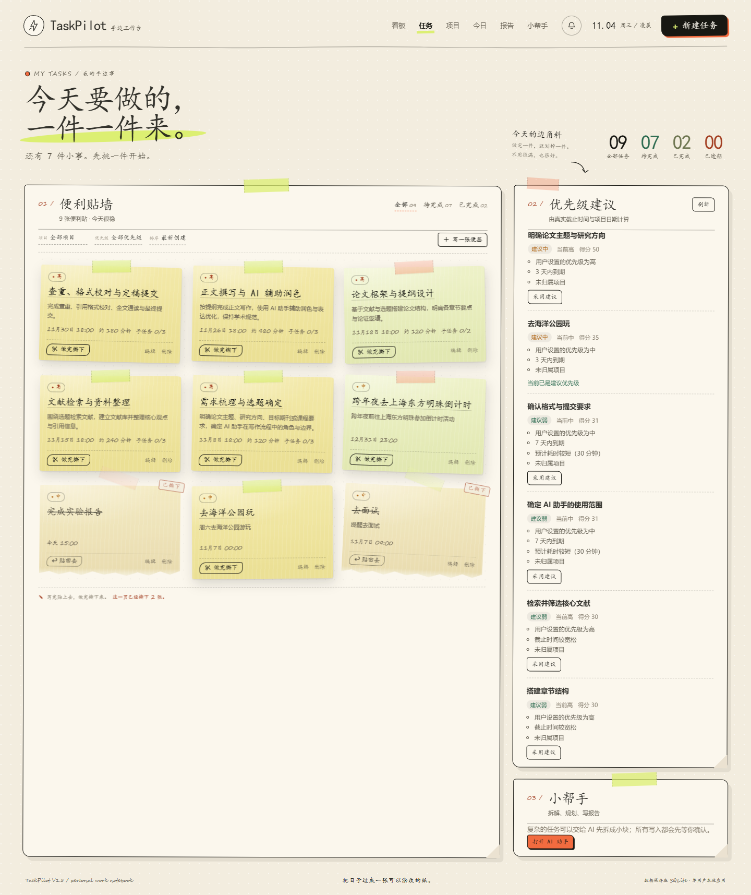
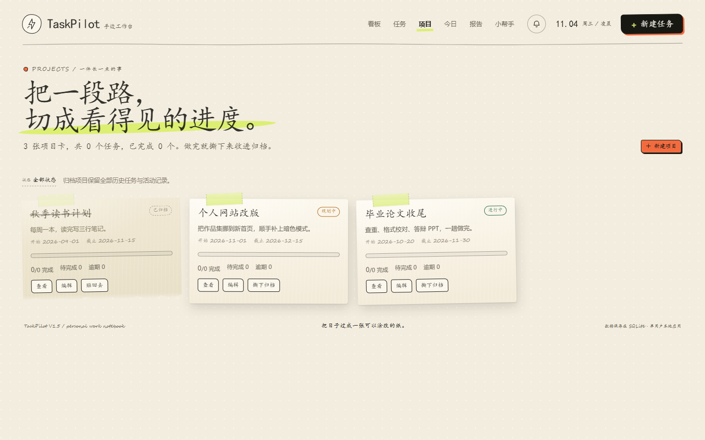
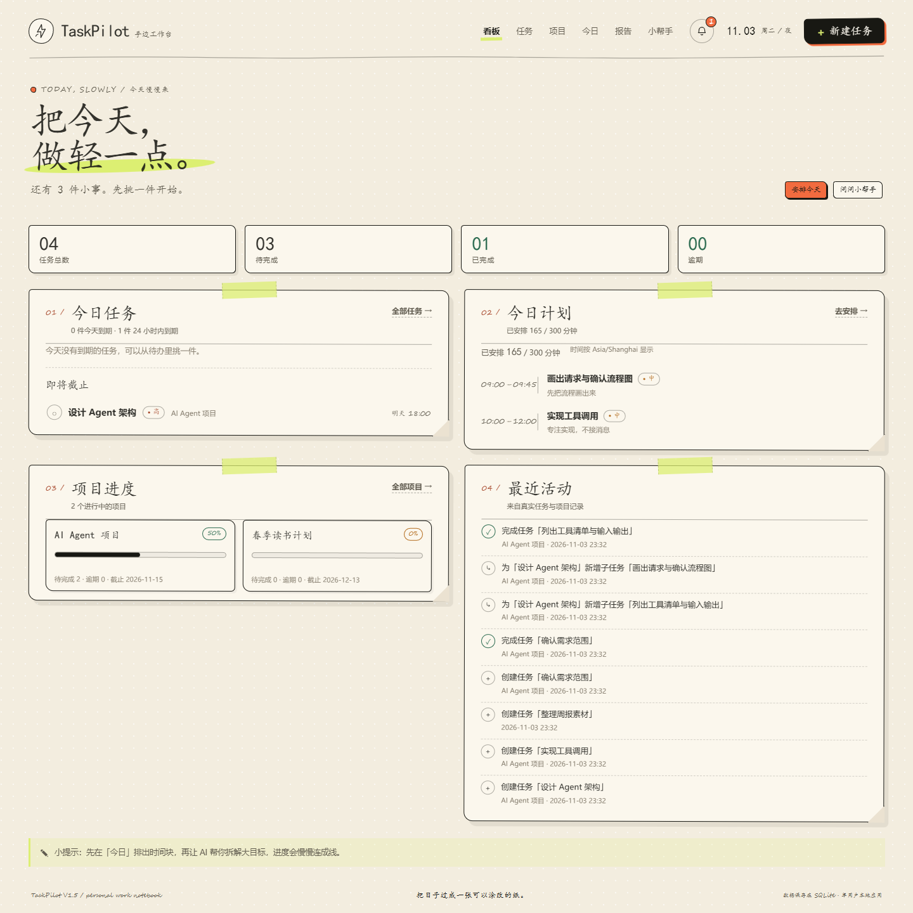
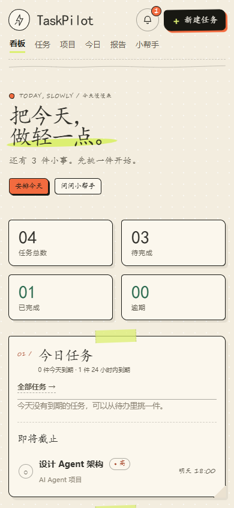

# TaskPilot V2.0

TaskPilot 是一个**单用户、本地优先的 AI 工作管理平台**。V2.0 在 V1.5（项目、子任务、AI 拆解、每日规划、提醒、报告）之上增加了**任务依赖、重复任务、专注记录、日历时间块、确定性重规划、风险识别与 Word/PDF 报告导出**。所有数据真实持久化，所有写操作都必须由用户明确确认；AI 只负责理解与解释，时间、依赖、容量等约束由后端程序校验。

后端 FastAPI + SQLAlchemy + SQLite + Alembic，Agent 基于 LangGraph + DeepSeek（OpenAI 兼容接口），前端 React 19 + TypeScript + Vite + Ant Design 6，通过原生 fetch/ReadableStream 接收 SSE 流式回复。

**打开应用默认进入「小帮手」**：所有写操作都可以在聊天里用文字或语音提出，先生成待确认卡片，确认后才写入；其他页面主要用于查看与少量手动调整。

> 本项目默认定位为本地单用户应用，不包含登录/多租户体系，请不要直接暴露到公网。

## V2.0 升级内容

| 功能 | 状态 | 说明 |
|---|---|---|
| F01 任务依赖 | 已实现 · 已测试 | 前置任务、循环/自依赖/重复/跨项目校验、阻塞状态（计算属性）、前置未完成禁止完成、项目变更保护 |
| F02 重复任务 | 已实现 · 已测试 | 每天/每周/每月/自定义每周、结束日期、暂停恢复、幂等生成（唯一约束兜底）、删除单次或整个系列、月末按当月最后一天 |
| F03 专注模式 | 已实现 · 已测试 | 服务端权威计时、开始/暂停/恢复/结束、刷新恢复、单会话互斥（部分唯一索引）、今日/本周统计、番茄钟时长；**圆形倒计时表盘**（进度环、刻度、呼吸光晕、达标彩纸、结束记录卡）；开始后可离开专注页，**右下角悬浮倒计时**跟随所有页面，可直接暂停/继续/结束 |
| F04 日历与时间块 | 已实现 · 已测试 | 月/周/日视图、项目筛选、时间块增删改、冲突与跨天校验；时间块与「今日」计划共用 `plan_items`，只有一份数据 |
| F05 动态规划 | 已实现 · 已测试 | 确定性重排引擎（依赖、优先级、容量、占用窗口）+ 前后差异 + 计划版本 token + 变更历史 `plan_revisions`；日历页「重排这天」预览后确认写入 |
| F06 风险识别 | 已实现 · 已测试 | 逾期、临近截止、依赖阻塞、长期无进展、工作量超容量、项目截止风险、计划偏差；可当天忽略；Dashboard 展示 |
| F07 报告增强 | 已实现 · 已测试 | 增强统计（完成趋势、专注时长、计划 vs 实际、风险）与 Markdown/DOCX/PDF 导出；新增**工作日报/工作周报模板**（今日完成 / 未完成及原因 / 明日计划 / 风险与协调 / 数据小结，周报另有每日数据表），按项目范围生成 |
| F08 Agent 工具 | 已实现 · 已测试 | 新增 `query_task_dependencies`、`query_focus_stats`、`analyze_task_risks`、`prepare_replan`、`prepare_create_project`；重排与建项目都走统一待确认流程，确认后单事务写入、重复确认幂等；提示词升级到 v7。聊天输入支持浏览器语音识别 |

数据库升级由 Alembic `0004_v2_0` 完成：新增 `task_dependencies`、`recurrence_rules`、`focus_sessions`、`plan_revisions`、`user_preferences`，`tasks` 增加 `recurrence_rule_id` / `occurrence_date`，`pending_actions` 重建以支持 `apply_replan`。升级前自动备份 SQLite（`taskpilot.db.bak-<UTC 时间戳>`），旧数据逐行保留。

### V2.0 API（新增）

| 方法 | 路径 | 功能 |
|---|---|---|
| GET/POST | `/api/dependencies/{task_id}` | 查看依赖 / 添加前置任务 |
| DELETE | `/api/dependencies/{task_id}/{dependency_id}` | 解除依赖 |
| GET | `/api/dependencies/summary` | 待办任务的未满足前置标题 |
| GET/POST | `/api/recurrences` | 重复规则列表 / 创建（并生成近期实例） |
| POST | `/api/recurrences/generate` | 按需幂等生成 |
| PATCH/DELETE | `/api/recurrences/{id}` | 修改规则 / 删除整个系列 |
| POST | `/api/recurrences/{id}/pause`、`/resume` | 暂停 / 恢复 |
| GET | `/api/focus/active`、`/api/focus/stats` | 当前会话 / 今日与本周统计 |
| POST | `/api/focus/start`、`/{id}/pause`、`/resume`、`/stop` | 专注生命周期 |
| GET | `/api/calendar?start=&end=&project_id=` | 日历范围（时间块 + 到期任务） |
| POST/PATCH/DELETE | `/api/time-blocks`、`/api/time-blocks/{id}` | 时间块增删改 |
| GET | `/api/insights` · POST `/api/insights/dismiss` | 风险列表 / 当天忽略 |
| POST | `/api/replan/preview`、`/api/replan/apply` | 生成重排方案 / 确认写入（token 过期拒绝） |
| GET/PATCH | `/api/preferences` | 时区、每日可用时间、工作日、默认专注时长 |
| POST | `/api/reports/enhanced` | 增强报告草稿（含专注、计划对比、趋势） |
| GET | `/api/reports/{id}/docx`、`/pdf` | 真实 Word / PDF 导出 |

### 专注悬浮窗

开始专注后切到任何页面，右下角都会留一张小便签：迷你进度环 + 剩余时间 + 任务名 + 已专注分钟数，暂停/继续/结束都能直接点；点击便签回到专注页。专注页本身不显示悬浮窗，避免重复。窗口每 30 秒与后端校对一次，切回标签页时立即同步。



### 助手主入口与语音

- 打开 <http://127.0.0.1:3000/> 默认落在 `#/assistant`；聊天框右侧有「🎙 语音」按钮，使用浏览器自带的语音识别（Chrome / Edge，普通话），识别结果写入输入框，仍需你点发送。
- 目前可在聊天里完成：建项目、建/改/删/完成任务、批量创建、任务拆解、今日计划、报告保存、按天重排、查询依赖/专注/风险/报告事实。
- 依赖关系、重复规则、专注开始/结束、单个时间块微调仍以页面操作为准（下一阶段接入）。

### V2.0 页面

- 日历（月/周/日、时间块、冲突提示、重排预览）：
- 专注（服务端计时、今日/本周统计）：
- 增强报告（真实统计 + 三种导出）：

### V2.0 已知限制

- 重复任务按需生成（读取任务/日历/专注接口时补齐未来 14 天），没有常驻后台调度器；生成幂等由 `(recurrence_rule_id, occurrence_date)` 唯一约束兜底。
- 月度重复遇到不存在的日期时，统一使用当月最后一天（例如 1 月 31 日 → 2 月 28/29 日）。
- 专注统计按会话开始日期归属到某一天；跨零点的长会话不会拆分到两天。
- PDF 使用 reportlab 内置的宋体 CID 字体（`STSong-Light`），不嵌入字体文件；正文里的柱状趋势用表格 + 字符条呈现。
- Agent 的 V2 工具链由脚本化模型的单元测试覆盖（工具调用、待确认操作、确认幂等、计划过期拒绝）；**真实 DeepSeek 多轮对话未做端到端验收**，无法保证模型一定按新提示词调用工具。
- 对话中的重排确认卡只展示摘要与确认按钮，没有像拆解/计划那样的可视化差异编辑器（差异在 `explanation`/`changes` 字段里，日历页的「重排这天」有完整预览）。

> 本项目默认定位为本地单用户应用，不包含登录/多租户体系，请不要直接暴露到公网。

## 界面预览

当前视觉方向为 **Paper Day / 纸上小帮手**：暖纸底、手写标题、胶带与手绘批注、原创墨线小工人和便签式 AI 面板。V1.5 新增的看板、项目、今日计划、报告、提醒中心沿用同一套纸张语言。

### 便利贴：贴上，撕下来

任务和项目都以真的便签出现。新建一张，便签带着胶带“啪”地贴到纸面上；做完了，就从撕口撕开——上半张飘走、下半张落下，纸上留下带撕边的便签和「已撕下」印章。撕下的还会留在这一页，点「贴回去」就能重新做。







<p align="center">
  
</p>

更多 V1.5 页面截图：

- [任务清单（子任务与优先级建议）](docs/assets/v15-tasks.png)
- [项目详情（进度、任务与最近活动）](docs/assets/v15-project.png)
- [今日计划（时间块与建议）](docs/assets/v15-today.png)
- [日报详情（可编辑与 Markdown 导出）](docs/assets/v15-report.png)
- [AI 助手（拆解 / 规划 / 报告）](docs/assets/v15-assistant.png)
- [提醒中心](docs/assets/v15-notifications.png)

以上截图来自隔离的临时数据库与本地开发服务器，不代表真实用户数据。

三方向设计探索与可交互对比页保留在 [`style-explorer.html`](style-explorer.html)，选定方向源码位于 [`explore/a.html`](explore/a.html)。插画和微工作者均为原创线稿，不使用任何官方品牌标识。

## 功能一览

### 任务与项目

- 任务的创建、编辑、删除、状态切换、筛选、排序、逾期标识。
- **便利贴墙**：新建任务即贴上一张手写便签（胶带、撕口、纸色随机）；「撕下」把便签撕成两半，撕下的留在纸上并盖「已撕下」章，可随时「贴回去」；子任务在任务详情抽屉里增删与排序。
- **项目便利贴**：新建项目以项目卡贴上，归档时撕下来收进归档，恢复即贴回去。
- 项目管理：名称、描述、开始/截止日期、状态（规划中/进行中/已完成/已归档）、归档与恢复。
- 项目进度由真实任务数据计算：无任务项目完成率为 0%；统计基于叶子任务（父任务不重复计数）。
- 任务可属于一个项目，也可不属于任何项目；移动任务会同步其子任务的项目。
- 项目详情：基本信息、完成数量与比例、逾期任务、任务列表、最近活动。

### 子任务与结构

- 两级结构：父任务 → 子任务；子任务默认继承父任务项目。
- 子任务可独立编辑、完成、删除、调整顺序；父任务展示 `已完成/总数`。
- 存在未完成子任务时禁止完成父任务，并返回明确原因。
- 删除包含子任务的父任务必须显式确认，接口与界面都会提示影响范围。

### AI 智能拆解、优先级与每日规划

- **任务拆解**：AI 查询真实项目与任务后生成可编辑草稿，包含标题、描述、项目、优先级、预计耗时、建议截止时间、子任务与执行顺序；你可以在确认前修改、删除、新增条目，确认后一次事务创建。
- **优先级建议**：由后端按用户优先级、截止时间、逾期状态、预计耗时、项目截止日期与任务状态确定性打分，并给出理由；AI 只负责解释，未经确认不会修改任务。
- **每日规划**：AI 用真实待办和可用时间生成时间块草稿；确认后保存。也提供确定性建议接口，界面可直接采用。
- 规划约束：不安排已完成任务、不超过可用时间、时间块不重叠、不虚构任务；缺失预计耗时按 30 分钟估算并标注。

### 提醒、活动与报告

- 应用内提醒中心：今日待办、即将截止（默认 24 小时）、逾期；已读/未读状态持久化，点击可跳转对应任务。
- 活动记录：任务创建/修改/完成/重开/删除/项目变更，项目创建/修改/状态变化；只记录真实成功的数据库操作。
- AI 日报、周报、项目进度报告：所有统计由后端按 `completed_at` 计算，报告明确统计时间范围；AI 只参与“存在的问题/后续建议”的文字组织，客观事实与 AI 建议分区展示。
- 报告可预览、编辑正文、保存、删除并导出 Markdown。

### AI 助手

- 自然语言查询任务、项目、子任务、活动与报告事实。
- 创建、编辑、删除、完成、批量改期、批量草稿、任务拆解、今日计划、报告保存全部走服务端待确认操作。
- 多轮上下文（最近 12 条）、SSE 流式回复、prompt 版本持久化；写操作轮次抑制模型正文，只展示服务端确定性确认卡片。
- AI 未配置、超时、鉴权失败或上游异常不影响手动任务、项目、计划与报告统计功能。

## 技术栈

| 层 | 技术 |
|---|---|
| 后端 | Python 3.13、uv、FastAPI、SQLAlchemy 2、SQLite、Pydantic 2、Alembic |
| Agent | LangGraph、LangChain OpenAI 兼容客户端、DeepSeek `deepseek-flash` |
| 前端 | React 19、TypeScript、Vite 8、Ant Design 6、Day.js |
| 测试 | Pytest、Ruff、Vitest、Testing Library、oxlint |
| 部署 | Docker、Docker Compose、Nginx、GitHub Actions |

## 快速开始（本地）

### 1. 前置条件

- [uv](https://docs.astral.sh/uv/)（会自动安装 Python 3.13）
- Node.js 24 与 npm
- Git
- 可选：Docker Desktop（用于容器运行）

### 2. 配置环境变量

在仓库根目录：

```powershell
Copy-Item .env.example .env
```

编辑 `.env`，至少确认：

```dotenv
APP_TIMEZONE=Asia/Shanghai
DEEPSEEK_API_KEY=你的 DeepSeek API Key
```

不填写 `DEEPSEEK_API_KEY` 也可以使用全部手动功能（任务、项目、子任务、计划、提醒、活动、报告的事实统计）。AI 助手与 AI 建议会返回明确提示；报告仍会生成确定性的统计正文，AI 建议区会说明未生成。

> 安全提醒：真实 Key 只能写入本地 `.env`，不要写进 `.env.example`、README、截图或提交记录。若 Key 曾出现在共享屏幕/聊天中，请立即在服务商控制台轮换。

### 3. 启动后端

```powershell
cd backend
uv sync
uv run uvicorn app.main:app --reload --host 127.0.0.1 --port 8000
```

- API：<http://127.0.0.1:8000>
- Swagger/OpenAPI：<http://127.0.0.1:8000/docs>
- 健康检查：<http://127.0.0.1:8000/api/health>

本地数据库默认位于 `backend/data/taskpilot.db`。启动时会自动执行 Alembic 迁移；迁移旧库前会在同目录生成 `taskpilot.db.bak-<时间戳>` 备份。

### 4. 启动前端

另开一个终端：

```powershell
cd frontend
npm ci
npm run dev
```

访问 <http://127.0.0.1:5173>。Vite 会将 `/api` 代理到 `http://127.0.0.1:8000`。页面使用 hash 路由：`#/dashboard`、`#/tasks`、`#/projects`、`#/today`、`#/reports`、`#/assistant`、`#/notifications`。

### 5. 本地预览生产构建（3000 端口）

不启动 Docker 时，也可以用构建产物在 3000 端口预览，与 Compose 的入口保持一致：

```powershell
cd frontend
npm run build
npm run preview
```

访问 <http://127.0.0.1:3000>，`/api` 同样代理到 `http://127.0.0.1:8000`。Compose 的 `frontend` 服务也占用 3000，两者不要同时运行。

## 数据库迁移与备份

V1.0/V1.2 → V1.5 的结构升级通过 Alembic `0003_v1_5` 完成：

- 新增 `projects`、`task_activities`、`daily_plans`、`plan_items`、`notifications`、`reports`。
- `tasks` 原地增加 `project_id`、`parent_id`、`priority`、`estimated_minutes`、`position`、`completed_at`，保留全部旧任务。
- 旧已完成任务回填 `completed_at = updated_at`，作为历史完成时间的可用证据。
- `pending_actions` 重建以扩展 action 类型，历史操作全部保留。

详见 [数据库迁移与恢复](docs/migration-v1.5.md)。

恢复备份（应用停止后）：

```powershell
Copy-Item backend\data\taskpilot.db.bak-20260101000000 backend\data\taskpilot.db -Force
```

## Docker Compose

```powershell
Copy-Item .env.example .env   # 可选；不创建也能启动手动模式
docker compose up --build -d
docker compose ps
```

访问：

- Web 界面：<http://127.0.0.1:3000>
- API 文档：<http://127.0.0.1:8000/docs>

常用命令：

```powershell
docker compose logs -f backend
docker compose logs -f frontend
docker compose down        # 保留 SQLite 数据卷
docker compose down -v     # ⚠️ 破坏性：删除全部容器数据
```

SQLite 数据保存在命名卷 `taskpilot-data`，正常重启/`down` 不会丢失。

## 环境变量

| 变量 | 默认值 | 说明 |
|---|---|---|
| `ENVIRONMENT` | `development` | 运行环境标识 |
| `DATABASE_URL` | `sqlite:///./data/taskpilot.db` | SQLAlchemy 数据库地址；Docker 内为 `/data/taskpilot.db` |
| `DATABASE_AUTO_MIGRATE` | `true` | 启动时自动备份并执行 Alembic 迁移 |
| `APP_TIMEZONE` | `Asia/Shanghai` | 相对时间解析、计划日期、报告范围与前端展示时区 |
| `CORS_ORIGINS` | `http://localhost:5173,http://127.0.0.1:5173` | 允许的前端来源，逗号分隔 |
| `DEEPSEEK_API_KEY` | 空 | 为空时 AI 不可用，手动功能正常 |
| `DEEPSEEK_BASE_URL` | `https://api.deepseek.com` | DeepSeek OpenAI 兼容 Base URL |
| `DEEPSEEK_MODEL` | `deepseek-flash` | 模型名称 |
| `AGENT_TIMEOUT_SECONDS` | `30` | 单次模型调用超时秒数（1–120） |
| `AGENT_MAX_RETRIES` | `1` | 模型客户端重试次数（0–3） |
| `AGENT_RECURSION_LIMIT` | `10` | LangGraph 递归上限 |
| `PENDING_ACTION_TTL_MINUTES` | `30` | AI 待确认操作有效期（1–1440） |
| `VITE_API_BASE_URL` | `/api` | 前端 API 前缀 |
| `VITE_APP_TIMEZONE` | `Asia/Shanghai` | 前端展示时区 |

**安全注意**：只有 `VITE_` 前缀变量会进入浏览器产物，`DEEPSEEK_API_KEY` 绝不能加 `VITE_` 前缀。`.env` 已被 `.gitignore` 忽略。

## 测试与质量检查

### 后端

```powershell
cd backend
uv sync
uv run ruff check app tests
uv run ruff format --check app tests
uv run pytest -q
```

### 前端

```powershell
cd frontend
npm ci
npm run lint
npm run typecheck
npm test
npm run build
```

测试特点：

- 使用临时隔离 SQLite 数据库，不污染本地开发库。
- 自动化测试中的外部 DeepSeek 调用全部通过脚本化模型/Mock 完成，不需要真实 API Key 或余额。
- 覆盖任务与项目 CRUD、子任务层级与完成守卫、计划校验与容量约束、提醒去重与已读状态、活动记录真实性、报告统计范围、AI 确认幂等、迁移数据保留、表单校验、页面交互与流式错误。
- **Mock 测试不等于真实模型验收**。真实模型输出具有非确定性，不能替代回归测试。V1.0/V1.2 的真实 Key 联调记录见[验收报告](docs/acceptance.md)；V1.5 的自动化验证范围与未执行项同样记录在该文档中。

## API

所有业务错误统一返回：

```json
{
  "error": {
    "code": "TASK_NOT_FOUND",
    "message": "任务不存在。"
  }
}
```

| 方法 | 路径 | 功能 |
|---|---|---|
| POST | `/api/tasks` | 创建任务（可带项目/优先级/预计耗时） |
| GET | `/api/tasks?status=&project_id=&priority=&include_subtasks=` | 任务列表 |
| GET | `/api/tasks/{id}` | 任务详情与子任务 |
| PATCH | `/api/tasks/{id}` | 修改任务字段/状态/项目/优先级/耗时 |
| DELETE | `/api/tasks/{id}?confirm_subtasks=false` | 删除任务；父任务需显式确认 |
| GET/POST | `/api/tasks/{id}/subtasks` | 子任务列表 / 创建子任务 |
| PUT | `/api/tasks/{id}/subtasks/order` | 调整子任务顺序 |
| POST/GET | `/api/projects` | 创建项目 / 项目列表 |
| GET/PATCH | `/api/projects/{id}` | 项目详情（含任务与活动）/ 修改项目 |
| POST | `/api/projects/{id}/archive`、`/restore` | 归档 / 恢复项目 |
| GET/PUT/DELETE | `/api/plans/{date}` | 获取 / 保存 / 取消某天计划 |
| GET | `/api/plans/{date}/suggestion?available_minutes=` | 确定性时间块建议 |
| GET | `/api/notifications` | 提醒列表（自动同步派生提醒） |
| GET | `/api/notifications/unread-count` | 未读数量 |
| POST | `/api/notifications/refresh`、`/read-all` | 重新同步 / 全部已读 |
| PATCH | `/api/notifications/{id}` | 标记已读或未读 |
| GET | `/api/activities` | 真实活动记录 |
| POST | `/api/reports/generate` | 生成报告草稿（不保存） |
| GET/POST | `/api/reports` | 报告列表 / 保存报告 |
| GET/PATCH/DELETE | `/api/reports/{id}` | 获取 / 修改 / 删除报告 |
| GET | `/api/reports/{id}/markdown` | 导出 Markdown |
| GET | `/api/dashboard` | 今日看板聚合数据 |
| GET | `/api/insights/priorities` | 优先级建议 |
| GET | `/api/assistant/history` | 持久化对话历史 |
| POST | `/api/assistant/messages` | 非流式对话 |
| POST | `/api/assistant/messages/stream` | SSE 流式对话 |
| POST | `/api/assistant/confirm` | 确认/取消待确认操作（可携带编辑后的草稿） |
| GET | `/api/health` | 健康检查 |

完整 Schema 与示例请查看运行后的 `/docs`。

## AI 安全流程

```text
用户消息
  → LangGraph 单 Agent
  → 受控工具（查询 / 优先级 / 规划 / 活动 / 报告事实 / prepare_*）
  → 服务端 pending_actions（唯一 ID + 过期时间）
  → 前端展示待确认卡片（拆解/计划可编辑）
  → 用户点击确认或取消（可提交编辑后的草稿）
  → POST /api/assistant/confirm
  → PendingActionService 单事务执行
```

- AI 工具不能直接访问数据库，不能执行代码、Shell 或文件操作。
- 未确认的创建/修改/删除/拆解/计划/报告**不会写入业务表**。
- 多个匹配任务时，Agent 不能自行选择；前端提供明确候选按钮。
- “抢占 pending 操作 + 写入 + 标记 confirmed”在同一个事务内完成；失败回滚，重复确认幂等。
- 批量任务拆解在一个事务内创建父任务与子任务；编辑后的草稿同样经过后端 Pydantic 校验。
- 超时、鉴权失败、连接失败、模型输出异常均映射为安全、可读的 API 错误，不泄露堆栈或密钥。

## 项目结构

```text
TaskPilot/
├── backend/
│   ├── app/
│   │   ├── api/              路由与依赖装配
│   │   ├── agent/            LangGraph、工具、提示词、DeepSeek、报告措辞
│   │   ├── repositories/     SQLAlchemy 数据访问
│   │   ├── services/         业务规则与事务
│   │   ├── schemas.py        Pydantic 模型
│   │   ├── models.py         ORM 模型
│   │   ├── migrations.py     启动迁移与旧库备份
│   │   └── main.py           应用工厂
│   ├── migrations/           Alembic 版本脚本（0001 → 0003）
│   ├── tests/
│   └── pyproject.toml
├── frontend/
│   └── src/
│       ├── components/       展示组件（含 Paper Day UI 基础件）
│       ├── pages/            看板 / 任务 / 项目 / 今日 / 报告 / 助手 / 提醒
│       ├── hooks/            页面级状态与数据操作
│       ├── services/         HTTP/API 映射与 DTO 转换
│       ├── types/            领域类型
│       ├── utils/            时间等纯函数
│       └── index.css         Paper Day 视觉入口
├── docs/
│   ├── requirements.md
│   ├── architecture.md
│   ├── acceptance.md
│   ├── agent-evals.md
│   └── migration-v1.5.md
├── scripts/
│   └── real_agent_smoke.py   真实模型冒烟脚本（隔离库）
├── .github/workflows/ci.yml
├── docker-compose.yml
├── .env.example
├── AGENTS.md
└── README.md
```

## 设计与已知限制

详细需求、架构与验收记录见：

- [需求规格](docs/requirements.md)
- [架构设计](docs/architecture.md)
- [验收报告](docs/acceptance.md)
- [数据库迁移与恢复](docs/migration-v1.5.md)
- [Agent 测试集与提示词版本](docs/agent-evals.md)

已知限制：

- 单用户本地应用，无认证/权限系统，禁止公网多用户部署。
- 聊天记录持久化，但不提供多会话切换、长期记忆或 RAG。
- 提醒仅限应用内：不发送邮件、短信或系统级推送；应用关闭时不主动通知。
- 每日计划为单日计划，不实现跨天自动重排或复杂日程优化。
- 报告正文为 Markdown 文本编辑，不提供富文本编辑器、PDF/Word 排版引擎。
- 项目统计按叶子任务计算（父任务为容器，不重复计数）；这一口径在项目详情与报告中保持一致。
- V1.5 已使用真实 DeepSeek 完成拆解、每日计划、优先级建议与报告四类冒烟（隔离临时数据库）；真实模型输出具有非确定性，自动化回归仍以 Mock/脚本化模型为主。
- 前端构建包含完整 Ant Design 依赖，暂未做路由级拆包。
